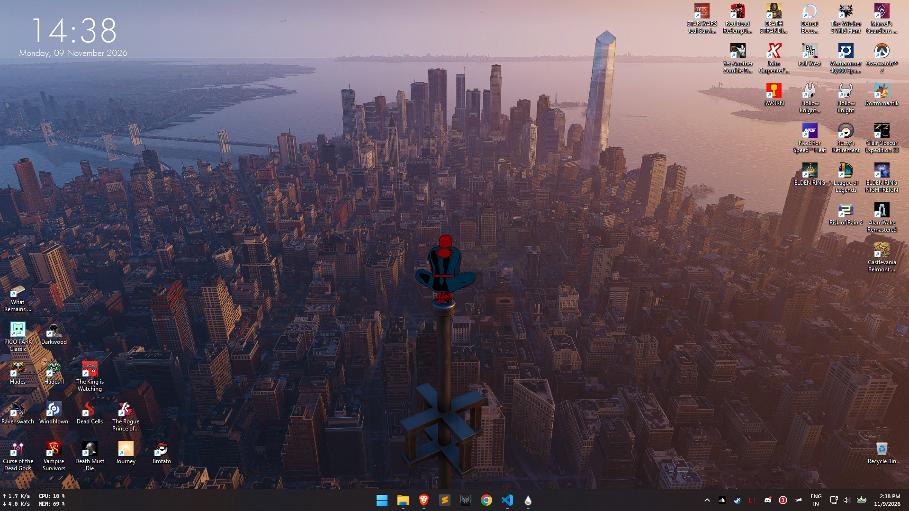
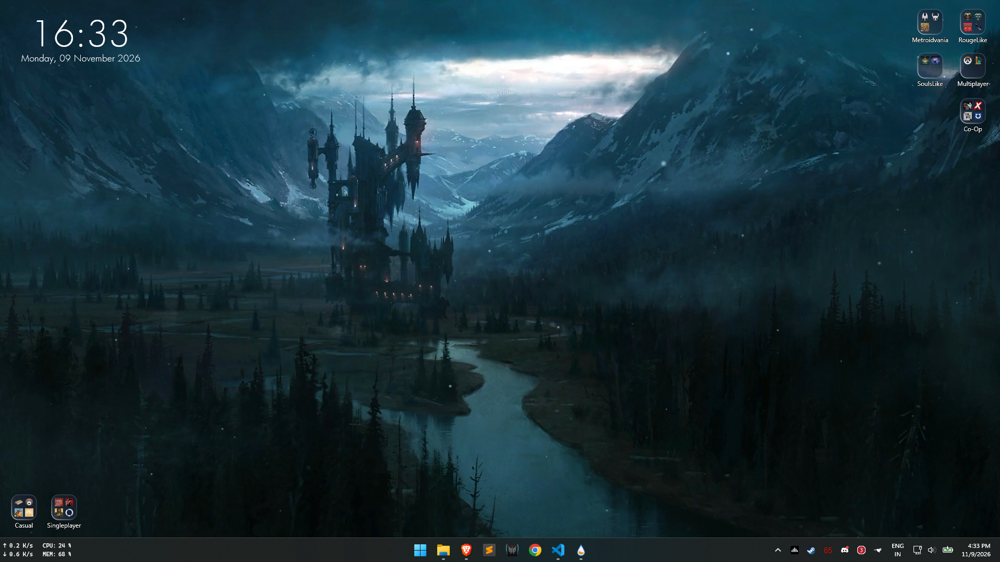
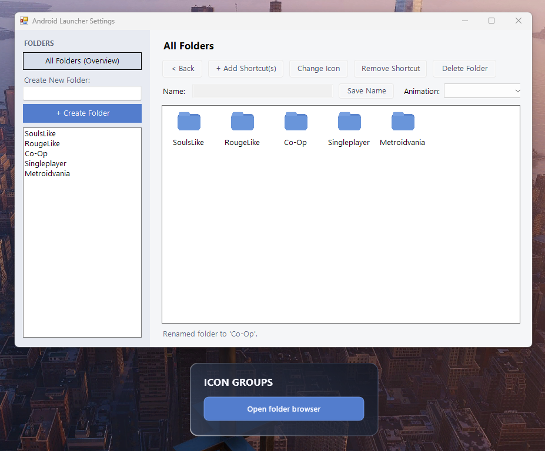
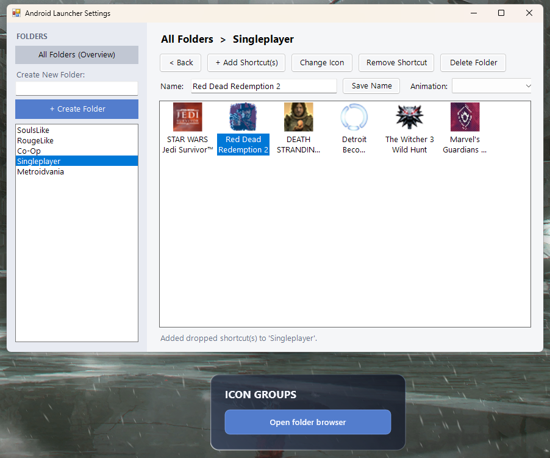

# Android-style Dynamic Rainmeter Launcher

A desktop-style launcher for Rainmeter, inspired by Android folders. It
organizes applications and files into independently movable desktop folders.
Open a folder to launch its shortcuts from an animated popup, and use the
built-in folder browser to manage your layout.

## Why I wanted to make it

A friend of mine called my desktop ugly and cluttered and I agreed.

## Features

- Create, rename, and delete folders from an all-folders overview
- Add files and shortcuts with the Windows file browser or drag and drop from
  File Explorer
- Automatically extract icons for supported targets or use a custom PNG, ICO,
  JPG, or BMP icon
- Rename shortcuts and drag them within the settings grid to reorder them
- Choose the animation used by folder popups: Expand/Collapse, Elastic Bounce,
  Slide, Fade, or None
- Open folders in a styled popup and launch shortcuts from an icon grid
- Move each folder independently on the desktop; Rainmeter remembers its
  position
- Keep launcher configuration and shortcut paths locally in `Data.json`

## Screenshots and video

### Desktop

Before organizing shortcuts into folders:



The desktop with Android Icon Groups:



### Folder browser

All-folders overview:



A folder selected for shortcut management:



### Popup animation

Watch the folder popup animation demo:

<video src="Docs/bounce-animation-recording.mp4" controls width="720">
  Your browser does not support embedded video.
</video>

[Open the animation recording](Docs/bounce-animation-recording.mp4).

## Requirements

- Windows
- [Rainmeter](https://www.rainmeter.net/)
- Windows PowerShell
- `.NET Framework` support for icon extraction and Windows Forms dialogs

## Installation

1. Close or exit the AndroidIconGroups skins if they are already running.
2. Copy the `AndroidIconGroups` folder into your Rainmeter skins directory,
   normally:

   ```text
   %USERPROFILE%\Documents\Rainmeter\Skins\
   ```

   If Rainmeter uses another skins directory, copy it there instead.
3. Open **Rainmeter Manage**, click **Refresh all**, and load
   `AndroidIconGroups\Launcher.ini`.
4. Click **Open folder browser** on the launcher skin to create folders and
   shortcuts in the settings window.
5. Position each generated folder where desired. Rainmeter remembers the
   location of each folder skin independently.

You can leave the folder browser open while configuring the launcher or close
it when you are done.

## First-time configuration

The first initialization creates local folders named **Work** and **Games**.
Use **All Folders (Overview)** and **Create Folder** to build your layout.
Select a folder to add shortcuts, rename it, change its animation, or remove
shortcuts. Drag files from File Explorer into the folder list or shortcut grid
to add them.

When adding a shortcut with the browser, select the target file, application,
or Windows shortcut and enter the name shown in the launcher. You can rename
shortcuts later from the settings window. Use **Change Icon** to choose a
custom PNG, ICO, JPG, or BMP image.

## Managing shortcuts and folders

| Action | Description |
| --- | --- |
| Create folder | Add a folder and generate its Rainmeter skin |
| Rename folder or shortcut | Change the selected folder or shortcut's display name |
| Add shortcut | Browse for a target or drag files from File Explorer |
| Reorder shortcuts | Drag shortcuts to change their order in the folder |
| Change icon | Replace a shortcut icon with a local image |
| Remove shortcut | Remove an entry from the selected folder |
| Choose animation | Set the popup animation used by folders |
| Delete folder | Remove a folder and its launcher entries |

Rainmeter skin files and extracted icons can be regenerated from the launcher
configuration. Do not manually edit generated folder INI files unless you
intend to regenerate them afterward.

## Local files and generated files

The following files are created or updated locally by the launcher:

| Path | Purpose |
| --- | --- |
| `@Resources\Data.json` | Launcher folders, shortcut targets, names, and icon references |
| `@Resources\FolderState.txt` | Last-known generated folder state |
| `Folders\<name>\Folder.ini` | Generated Rainmeter skin for each folder |
| `@Resources\Icons\app_*.png` | Automatically extracted shortcut icons |
| `@Resources\Icons\custom_*.png` | Icons imported through the custom-icon controls |

Back up `@Resources\Data.json` before moving the skin to another computer or
restoring an older copy. Shortcut paths are local Windows paths and may need
to be re-added if the target location differs.

## Development

The core files are:

- `Launcher.ini` - launcher skin and entry point to the folder browser
- `@Resources\Scripts\FolderManager.ps1` - configuration and skin generation
- `@Resources\Scripts\FolderPopup.lua` - folder popup and animation behavior
- `@Resources\Scripts\LoadFolders.lua` - Rainmeter folder-loading behavior
- `@Resources\FolderTemplate.inc` - shared generated-folder template

Screenshots and the popup animation recording shown above are in `Docs/`.

Generated configuration, state, and extracted/custom icon files are ignored
by Git. Static artwork in `@Resources\Icons` remains included.

## Notes and limitations

- This is a launcher overlay; deleting an entry does not delete its original
  application, file, or Windows shortcut.
- Folder skins are regenerated when configuration changes.
- Dragging a shortcut in the folder browser changes its order; dragging a file
  from File Explorer adds it to the selected folder.
- Icon extraction depends on Windows and the target file type. Some packaged
  applications, network targets, and unusual file formats may fall back to a
  generic icon.
- The settings actions launch Windows Forms and require a desktop session.
- Some organization-managed systems block PowerShell scripts or custom
  execution policies. In that case, the script may require an approved policy
  or a signed launcher helper.
