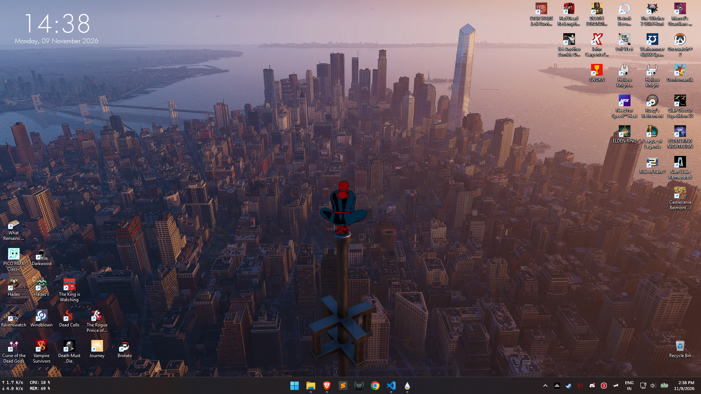
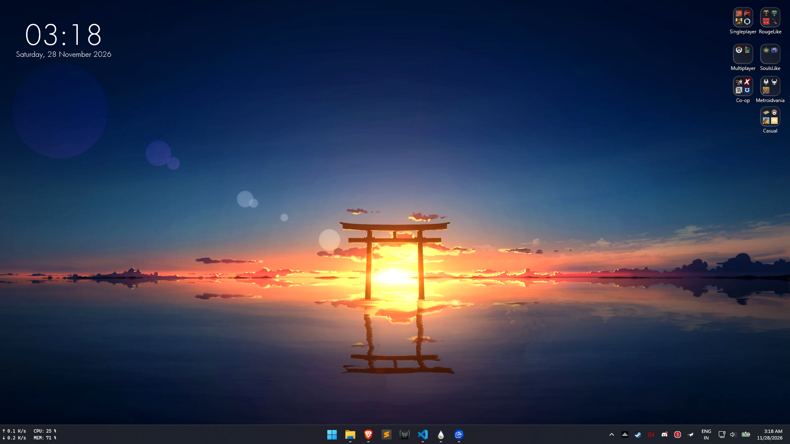
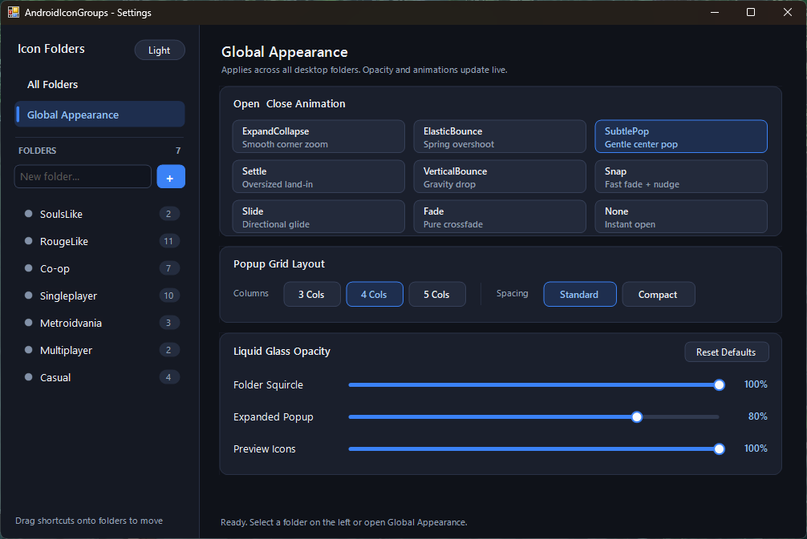

# Android Icon Groups for Rainmeter

An Android-style desktop folder launcher for Rainmeter featuring translucent liquid-glass squircles, animated popup grids, per-folder accent tinting, and a WinForms Settings UI.

## Why I wanted to make it

A friend of mine called my desktop ugly and cluttered and I agreed.

## Features

- **Per-Folder Glass Tint & Glow**: Assign an optional accent color per folder (8 presets or custom picker) to tint the desktop squircle, rim highlights, and expanded popup outer glow.
- **Folder & Shortcut Icons**: Automatic 2x2 miniature previews on desktop folders, plus custom folder and shortcut icon overrides with one-click restore.
- **Configurable Grid Layout**: Switch between **3, 4, or 5 columns** and **Standard** or **Compact** spacing.
- **9 Transition Animations**: `ExpandCollapse`, `ElasticBounce`, `SubtlePop`, `Settle`, `VerticalBounce`, `Snap`, `Slide`, `Fade`, and `None`.
- **Live Opacity Sliders**: Independently adjust Folder, Popup, and Preview opacity in real time with persistent settings.
- **Drag-and-Drop Settings UI**: Drop files/shortcuts from Windows Explorer, drag to reorder shortcuts inside a folder, or drag shortcuts onto sidebar folders to move them between categories.
- **Full-Tile Interaction**: Smooth hover fades, click-to-select, and double-click-to-launch across the entire shortcut tile boundary.
- **Multi-Monitor & Mixed-DPI Support**: Calculates screen edges, taskbars, and display seams across mixed DPI setups so edge folders expand inward without shifting position.

## Requirements

- Windows 10 / 11
- [Rainmeter](https://www.rainmeter.net/)
- Windows PowerShell 5.1+

## Installation

### Option 1: `.rmskin` Package (Recommended)

1. Download the latest `.rmskin` file from the **Releases** page.
2. Double-click the `.rmskin` file to install it in Rainmeter (`AndroidIconGroups\Launcher.ini` loads automatically).
3. Click **Open folder browser** on the launcher skin to start configuring folders.

### Option 2: Manual Installation

1. Unload any active `AndroidIconGroups` skins.
2. Copy the `AndroidIconGroups` folder into your Rainmeter skins directory:

   ```text
   %USERPROFILE%\Documents\Rainmeter\Skins\
   ```

3. Open **Manage Rainmeter**, click **Refresh all**, and load `AndroidIconGroups\Launcher.ini`.
4. Click **Open folder browser** to manage folders and shortcuts.

## Screenshots and screen recordings

### Popup animation

https://github.com/user-attachments/assets/0ef8dd39-c939-4c3f-af07-2b8bd8c734b6

### Drag & Drop shortcuts

https://github.com/user-attachments/assets/60a4a450-50d7-4ddd-bb9f-df77362198b6

### Folder tint color options

https://github.com/user-attachments/assets/8062b525-322e-4c9c-a8d2-fabbd581699e

### Desktop

Before:



After:



### Folder browser

All folders overview:


Single Folder overview:


Global settings overview:



## Project Structure

- `@Resources/Data.json` — Folders, shortcuts, layout, animation, opacity, and per-folder `accentColor`.
- `@Resources/FolderTemplate.inc` — Shared liquid-glass squircle, outer glow, popup, and highlight meters.
- `@Resources/Scripts/FolderPopup.lua` — Animations (`TransformationMatrix`), hover fades, and multi-monitor/DPI edge clamping.
- `@Resources/Scripts/FolderManager.ps1` — Settings UI, icon extraction, `Folder.ini` generator, and display metrics writer.
- `@Resources/MonitorMetrics.lua` — Auto-generated local monitor/DPI metadata (add to `.gitignore`).

## Regenerating folders from `Data.json`

Rebuild all `Folder.ini` files from `@Resources\Data.json` (keeps existing icons):

```pwsh
powershell.exe -NoProfile -STA -ExecutionPolicy Bypass -File "$HOME\Documents\Rainmeter\Skins\AndroidIconGroups\@Resources\Scripts\FolderManager.ps1" -Action ResetLayout
```

Rebuild all `Folder.ini` files and re-extract shortcut icons:

```pwsh
powershell.exe -NoProfile -STA -ExecutionPolicy Bypass -File "$HOME\Documents\Rainmeter\Skins\AndroidIconGroups\@Resources\Scripts\FolderManager.ps1" -Action Initialize
```

## Release process

Pushing a version tag triggers GitHub Actions to build the `.rmskin` package and publish a GitHub Release:

```bash
git tag v1.0.0
git push origin v1.0.0
```
