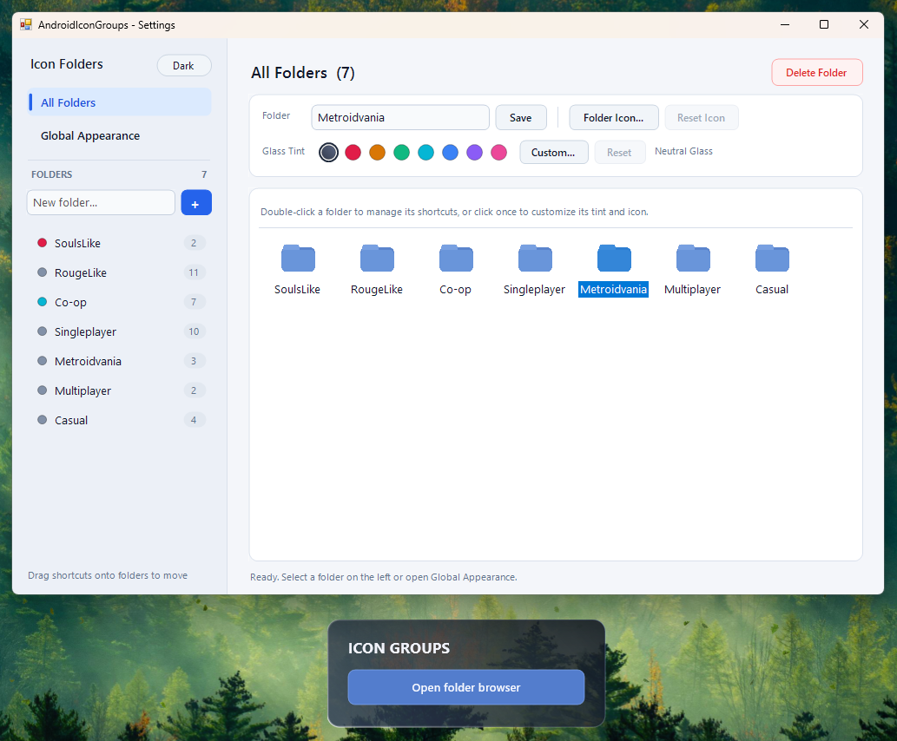
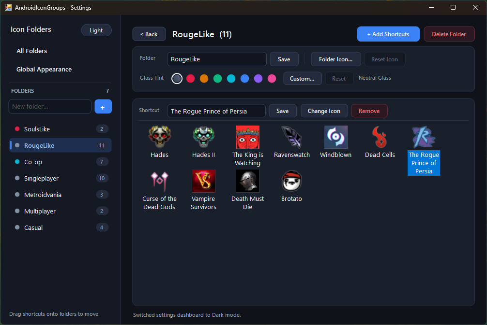

# Android-style Dynamic Rainmeter Launcher

A desktop launcher for Rainmeter inspired by Android app folders. Group apps and files into independently movable folders that open into an animated popup grid, managed through a built-in folder browser.

## Why I wanted to make it

A friend of mine called my desktop ugly and cluttered and I agreed.

## Features

- **Folder management:** Create, rename, and delete folders from an all-folders overview.
- **Easy shortcut import:** Add apps, files, or shortcuts via the file browser or drag and drop from File Explorer.
- **Custom icons & reordering:** Automatically extract icons, import custom `PNG`/`ICO`/`JPG`/`BMP` images, and drag shortcuts to reorder them.
- **Animations & hover effects:** Choose between `ExpandCollapse`, `ElasticBounce`, `Slide`, `Fade`, or `None`, with a Windows Start-style hover highlight on shortcut tiles.
- **Opacity controls:** Adjust folder background and 2x2 preview icon transparency from the settings window.
- **Independent positioning:** Move each folder anywhere on the desktop; Rainmeter remembers each position.
- **Local storage:** Stores all folder layouts and shortcut paths locally in `@Resources\Data.json`.

## Screenshots and video

### Desktop

Before:


After:


### Folder browser

All-folders overview:



Folder selected for shortcut management:



### Popup animation

https://github.com/user-attachments/assets/ca3c0eb9-39a6-45ed-a428-d71b3415b1a9

[Open the animation recording](Docs/bounce-animation-recording.mp4)

## Requirements

- Windows 10 or later
- [Rainmeter](https://www.rainmeter.net/)
- Windows PowerShell
- `.NET Framework` (for icon extraction and Windows Forms dialogs)

## Installation

### Option 1: `.rmskin` Package (Recommended)

1. Download the latest `.rmskin` file from the **Releases** page.
2. Double-click the `.rmskin` file to install it in Rainmeter (`AndroidIconGroups\Launcher.ini` loads automatically).
3. Click **Open folder browser** on the launcher skin to start configuring folders.

### Option 2: Manual Installation

1. Unload any active `AndroidIconGroups` skins.
2. Copy the `AndroidIconGroups` folder into your Rainmeter skins directory:

   ```text
   %USERPROFILE%\Documents\Rainmeter\Skins\
   ```

3. Open **Manage Rainmeter**, click **Refresh all**, and load `AndroidIconGroups\Launcher.ini`.
4. Click **Open folder browser** to manage folders and shortcuts.

## Usage

First-time initialization creates starter folders named **Work** and **Games**. Drag each generated folder wherever you want on your desktop.

| Action | How to do it |
| --- | --- |
| Create folder | Enter a name in the sidebar and click **+ Create Folder** |
| Add shortcut | Select a folder and click **+ Add Shortcut(s)**, or drag files from File Explorer |
| Reorder shortcuts | Drag and drop shortcuts inside the settings grid |
| Rename | Select a folder or shortcut, edit the **Name** field, and click **Save Name** |
| Change icon | Select a shortcut and click **Change Icon** (`PNG`, `ICO`, `JPG`, or `BMP`) |
| Change animation | Pick a style from the **Animation** dropdown |
| Adjust opacity | Use the **Folder Opacity** and **Preview Opacity** sliders |
| Remove / Delete | Click **Remove Shortcut** or **Delete Folder** |

> Avoid manually editing generated `Folder.ini` files; they are overwritten whenever settings change.

## Regenerating folders from `Data.json`

Rebuild all `Folder.ini` files from `@Resources\Data.json` (keeps existing icons):

```pwsh
powershell.exe -NoProfile -STA -ExecutionPolicy Bypass -File "$HOME\Documents\Rainmeter\Skins\AndroidIconGroups\@Resources\Scripts\FolderManager.ps1" -Action ResetLayout
```

Rebuild all `Folder.ini` files and re-extract shortcut icons:

```pwsh
powershell.exe -NoProfile -STA -ExecutionPolicy Bypass -File "$HOME\Documents\Rainmeter\Skins\AndroidIconGroups\@Resources\Scripts\FolderManager.ps1" -Action Initialize
```

## File structure

### Core files

- `Launcher.ini` — Entry point skin to open the folder browser
- `@Resources\FolderTemplate.inc` — Shared layout and styling template for generated folders
- `@Resources\Scripts\FolderManager.ps1` — Settings UI, icon extraction, and skin generator
- `@Resources\Scripts\FolderPopup.lua` — Popup animations, hover highlights, and positioning logic
- `@Resources\Scripts\LoadFolders.lua` — Loads generated folder skins on startup
- `Icons\` — Static fallback icons (`folder.png`, `app_default.png`)
- `Docs\` — Screenshots and demo video

### Local generated files (ignored by Git)

| Path | Purpose |
| --- | --- |
| `@Resources\Data.json` | Folders, shortcut paths, names, animation, and opacity settings |
| `@Resources\FolderState.txt` | Last-known generated folder list |
| `Folders\<name>\Folder.ini` | Generated Rainmeter skin for each folder |
| `Icons\app_*.png` | Extracted shortcut icons |
| `Icons\custom_*.png` | User-imported custom icons |

Back up `@Resources\Data.json` before moving the skin to another PC. Shortcut paths are machine-specific and may need to be re-added if paths differ.

## Release process

Pushing a version tag triggers GitHub Actions to build the `.rmskin` package and publish a GitHub Release:

```bash
git tag v1.0.0
git push origin v1.0.0
```

## Notes and limitations

- Deleting a folder or shortcut only removes it from the launcher, not from disk.
- Icon extraction depends on Windows; some packaged apps or network targets may fall back to `app_default.png`.
- The settings UI uses Windows Forms and requires an active desktop session.
- Managed systems with strict PowerShell execution policies may block `FolderManager.ps1`.